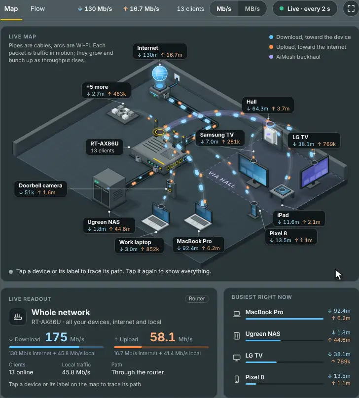
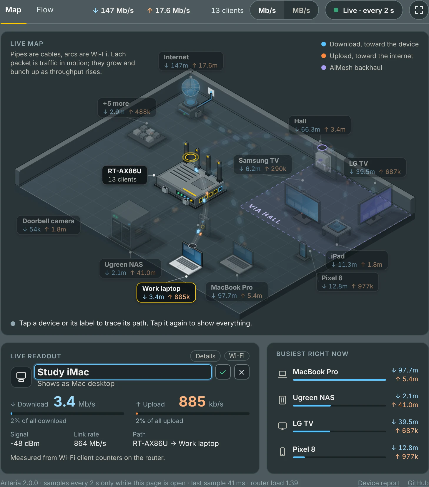
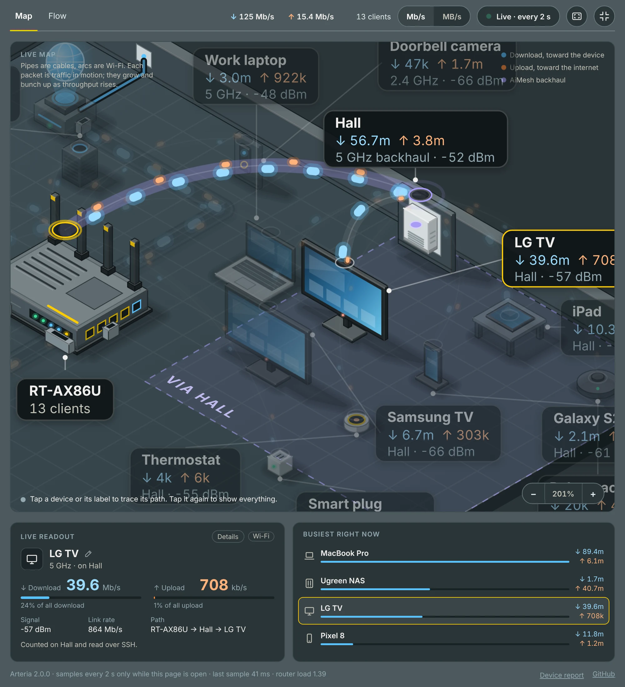
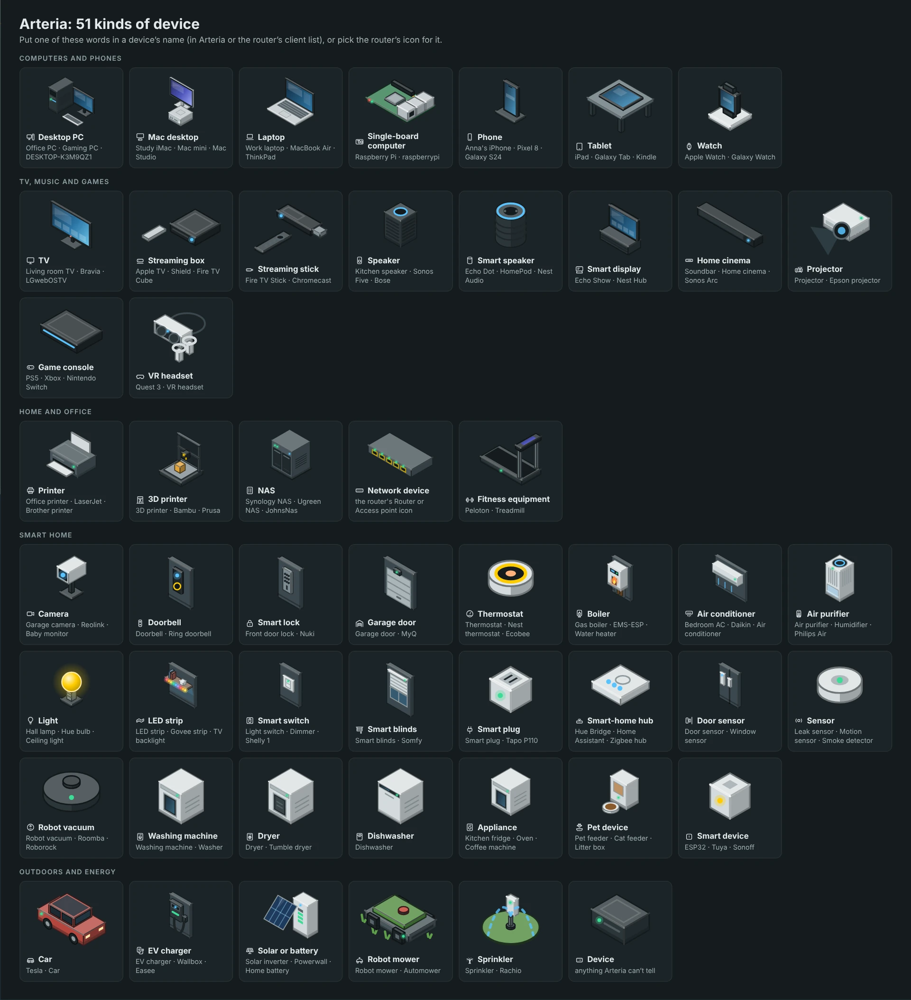

# Arteria for Asuswrt-Merlin

A live, animated map of how traffic flows through your home network: from the internet, through your router and its AiMesh nodes, to every device. Written on an RT-AX86U (3004.388.x) with an AiMesh node, and reported working on the RT-BE88U, GT-AX6000, GT-AX11000 Pro, ZenWiFi Pro XT12, RT-AX88U, GT-BE98 Pro and RT-BE92U. `arteria.sh check` tells you whether your router can run it before anything is installed.

It only works while you're looking: sampling starts when you open its page and stops when you close it. No cron jobs, no background service, nothing written to flash while it runs, and it backs off by itself when the router is busy.

<p align="center"><br><sub>Made-up sample data. Recorded with <code>.github/demo-gif.py</code>.</sub></p>

> [!WARNING]
> **Use it at your own risk.** Arteria was generated by Claude Opus 5.5, Anthropic's AI, with design help from Claude Fable 5.2. I'm a Java developer, not a router firmware or shell scripting specialist: I described what I wanted and tested it on my own router. It runs as root. AI reviewers checked it for security before each release and what they found was fixed, but no human security expert has reviewed it yet. It's provided as is, without warranty ([MIT licence](LICENSE)). Read [What it changes on your router](#what-it-changes-on-your-router) before installing.

## What you get

An **Arteria** tab in **Traffic Analyzer** (or the last tab of **Network Tools** on routers without it), with:

- **Map**: an isometric drawing of your network. Cables are pipes, Wi-Fi links are arcs, and each moving packet is traffic: blue toward the device (download), orange toward the internet (upload), violet the AiMesh backhaul. Packets grow and bunch up as throughput rises. Devices behind a node stand in its zone; on a busy network the quietest ones wait on a *+N more* tray, which opens a list.
- **Flow**: a Sankey "river" from the internet (and traffic between your own devices) through the router, each band, port and node, to every device, for download or upload.
- **Trace any device**: tap it and everything else dims. The readout shows its rates, share, signal, link rate and path (*RT-AX86U → Hall → LG TV*), and **Details** shows its IP and MAC, host name, maker, system, Wi-Fi standard, connection time, IPv6 and DHCP lease.
- **Rename it right there**: the pencil after its name opens a field; the icon shows what the new name will make it while you type. The name goes into the router's own client list, so the router shows it too. See [Devices](#devices).
- **51 kinds of device**, each with its own drawing and icon, recognised by name, by the icon you picked in the router, or by maker. AiMesh nodes and routers are drawn by model.
- **Expanded view**: fills the window (or the screen), with a stand for about 30 devices and a third line on each label. Its map **zooms and pans** like a whiteboard: the mouse wheel or a pinch zooms around the pointer, dragging or two fingers move around, and **− / 100% / +** zoom in steps or show the whole map.
- **AiMesh nodes, per device**: the router reads each node's own clients over SSH while the page is open. Without that, each node shows its backhaul total. **Dual WAN** counts both WANs as internet, and devices on a **Guest Network Pro** LAN port are placed on it.
- **Mb/s or MB/s** with one switch, and notices for a weak or offline backhaul, a node that can't be read, or a router that's too busy.

<details>
<summary>How the numbers are made</summary>

Every 2 seconds while the page is open the router writes one sample (in RAM), and the page turns the differences between samples into rates.

- **Wi-Fi devices**: the driver's per-client byte counters (`wl sta_info`), which also give signal and link rate; on a node, the same counters, read on the node.
- **Wired devices**: the router's port counters, with the LAN bridges' address tables telling which device is on which port. Devices behind one switch share that port's figure; an unmanaged switch doesn't show, and its devices appear on the router port it's plugged into.
- **Internet**: the WAN interface's counters (both, with Dual WAN). **Local traffic** is what your devices send each other or the router itself, which is why *Whole network* is usually higher than *Internet*.
- **Names and details** come from the router's own client list, DHCP leases and reservations, ARP and IPv6 neighbours, and the Wi-Fi driver.

Reading these counters doesn't disturb Wi-Fi or change any setting.
</details>

## Screenshots

<table>
<tr>
<td width="50%"><a href="docs/map.webp"></a><br><b>Map</b>: every device, where it's connected and how much is flowing</td>
<td width="50%"><a href="docs/flow.webp"></a><br><b>Flow</b>: where the traffic goes, as a river</td>
</tr>
<tr>
<td width="50%"><a href="docs/map-sel.webp"></a><br><b>Tracing a device</b> through the node</td>
<td width="50%"><a href="docs/details.webp"></a><br><b>Details</b>: who a device is and how it's connected</td>
</tr>
<tr>
<td width="50%"><a href="docs/rename.webp"></a><br><b>Renaming</b>: the icon shows what the name will make it</td>
<td width="50%"><a href="docs/zoom.webp"></a><br><b>Zoomed in</b> on the expanded map</td>
</tr>
<tr>
<td colspan="2"><a href="docs/expanded.webp"></a><br><b>Expanded</b>: the whole window, a stand for every device, and more on each label</td>
</tr>
</table>

<sub>Screenshots use made-up sample data (taken with <code>.github/screenshots.py</code>).</sub>

## Install

Over SSH on the router (needs Asuswrt-Merlin on a Broadcom model; no Entware or USB drive):

```sh
d=/tmp/arteria-install; rm -rf "$d" && mkdir -m 700 "$d" && curl -fsL --retry 3 "https://github.com/IfSugar/arteria/releases/latest/download/arteria.sh" -o "$d/arteria.sh" && sh "$d/arteria.sh" install; rm -rf "$d"
```

The installer checks everything first and changes nothing if a check fails. It turns on *JFFS custom scripts and configs* if needed, copies the addon to `/jffs/addons/arteria/`, hooks itself into `services-start` and `service-event`, mounts the page, and, if you have AiMesh nodes, offers to give them the router's key (see [AiMesh nodes](#aimesh-nodes)). Then open **Traffic Analyzer → Arteria**. No tab? Reload with **Ctrl+F5** / **Cmd+Shift+R**: browsers cache the router's menu. The installer also prints a direct link.

<details>
<summary>Without internet access on the router</summary>

Download `arteria.sh` and `arteria.asp` from the latest release, copy both to the router (use your router's IP and SSH user), then run the installer:

```sh
ssh admin@192.168.50.1 'd=/tmp/arteria-install; rm -rf "$d" && mkdir -m 700 "$d"'
scp -O arteria.sh arteria.asp admin@192.168.50.1:/tmp/arteria-install/
ssh admin@192.168.50.1 'sh /tmp/arteria-install/arteria.sh install; rm -rf /tmp/arteria-install'
```
</details>

**Update** with `/jffs/addons/arteria/arteria.sh update`: it installs the latest release over the old one, keeping your settings, the node key and the page slot. `update dev` installs the newest unreleased code on `main` (`update dev <branch>` another branch of this repository); plain `update` goes back to the release. Run the script with no arguments for a menu, which amtm opens too (see [amtm](#amtm)).

## Devices

<p align="center"><a href="docs/devices.webp"></a><br><sub>Every kind, with names that make a device that kind (drawn with <code>.github/device-gallery.py</code>).</sub></p>

**How a kind is chosen**, first match wins:

1. **The icon you chose** for the device in the router's client list (*Network Map → Clients*), when it's a specific one. When the icon is just the router's own guess, or a computer, phone, tablet, watch or console icon on a device named after a home device, the name decides instead.
2. **Its name**: the nickname you gave it, or its own host name (`DESKTOP-…` is a Windows PC, `wiz_…` a bulb, `LGwebOSTV` a TV). The rules look for words, not your device names, and words run together count too: *JohnsNas*, *KidsTV* and *office_printer* are read like *John's NAS*.
3. **What the router detected**, and whether a Windows device is wired (a desktop) or on Wi-Fi (a laptop).
4. **Its maker** and the DHCP vendor class it sent.

**To change how a device is drawn**, rename it with the pencil in the live readout (or give it a nickname in the router's client list) and put one word in the name that says what it is: *Bedroom AC*, *Hall plug*, *Kitchen dishwasher*. Enter or the check saves it in the router's client list, Escape or the cross keeps the old name, and an empty name brings the router's own back. It works for offline devices too, and each rename starts from the router's list as it is at that moment, so no other entry changes. Or pick the right icon in the router's client list. If it's still wrong, the **Device report** link at the bottom of the page shows how each device was recognised, without names or addresses; paste it into an issue.

**Private Wi-Fi addresses** (made-up MAC addresses that phones and computers use per network) are marked as such in Details. When one changes and the device has no name, Arteria finds its old nickname by a distinctive host name (*Toms-iPad*). For the steadiest names, set Apple devices' *Private Wi-Fi Address* to *Fixed* for your home network.

## AiMesh nodes

The router only knows each node's backhaul total. To show the devices on a node, Arteria asks the node itself, over SSH, while the page is open: one session per node, running a small read-only loop that prints its clients' counters. The session ends when you close the page (or after 30 minutes).

- **A key only the router holds.** The installer, or `arteria.sh nodekey` later, creates a key in `/jffs/addons/arteria/node_key` and adds it to each node, asking for the node's password once (your router's admin password; it goes to the node only and is never stored). It also adds the key to the router's own *Authorized Keys*, because AiMesh copies that list to the nodes. The key never leaves the router (root only), but a JFFS backup includes it, so keep backups private.
- **Already logging in to your nodes from the router?** If root has a key that opens them (`~/.ssh/id_dropbear`, as the forum's passwordless guide and the Wireless Report addon set up), Arteria uses it, and trusts each node as root's `known_hosts` does: nothing to set up.
- **Key login only, never a password.** Each node's SSH identity is pinned, and `nodekey` sends a password only to a node whose fingerprint you confirmed there. If a node's identity changes, the page says so and `nodekey` asks before trusting the new one.
- **Nodes that don't take passwords** (*Allow Password Login* off): `nodekey` puts the key in the router's list only. A node loads that list when it starts, so reboot the node (AiMesh page), then run `nodes test`.
- **Nodes with ASUS's own firmware** take only the first key of the router's list; `nodekey` warns you when another key is already listed.
- **Check it** with `arteria.sh nodes test`: key login, which key works, and one round of the page's script on each node (how many devices, how long). If something crashes on a node, it saves a trace (no addresses) for a bug report. A node that's slow still counts as answering, at its own pace.

Nothing on a node changes except the one line in its authorized keys. To stop reading nodes, set `NODES=off` in the config.

## Light on the router

- **Nothing while the page is closed.** No cron jobs, no background service. While it's open: one sample every 2 seconds at the lowest CPU priority (`nice 19`), plus one SSH session per node. The page's footer shows how long the last sample took and the router's load.
- **Why the heartbeat is every 45 seconds.** The page keeps sampling going by asking the router every so often, through the router's *service-event* hook, and the router writes two lines to its system log for each request. In 1.0.0 that was every 8 seconds, about 900 lines an hour; now it's every 45 seconds, about 160. The map still updates every 2 seconds: the page reads the latest sample file, which runs nothing on the router. Closing or pausing the page stops sampling at once; a hidden tab or a sleeping laptop stops it after 2 minutes.
- **A busy router is left alone.** While it samples, Arteria watches the load and the memory available:
  - **Busy** (a load of 2 per CPU core, or under 48 MB available): it samples a third as often and opens no new node sessions.
  - **Overloaded** (4 per core, or under 24 MB) when the page opens or for three samples in a row, or a sample that takes over 15 seconds twice: it stops for 2 minutes. The page says why, the system log gets a line, and `status` shows the last pause. Then the open page starts it again if the router has recovered.
  - **No samples for a minute**: the page stops asking and says what to check; its **Stopped** button tries again.
- **Bounded.** A node that floods its output is cut off at about 1 MB and reconnected; samples stay a few KB in RAM.

**If a router ever stops responding** with addons installed and you can still reach its web page, turn off *Administration → System → Enable JFFS custom scripts and configs* and reboot: no addon starts, Arteria included, and nothing is deleted. Then run `arteria.sh uninstall` over SSH (or look into whatever else was wrong) and turn the setting back on. No factory reset needed.

## Commands

```sh
/jffs/addons/arteria/arteria.sh               # the menu (in a terminal; amtm opens this too)
/jffs/addons/arteria/arteria.sh check         # can this router run it? (changes nothing)
/jffs/addons/arteria/arteria.sh status        # sampling?, the router's load and memory, the last pause, node access
/jffs/addons/arteria/arteria.sh doctor        # look for known problems (doctor fix: fix the ones it can)
/jffs/addons/arteria/arteria.sh nodes test    # key login and one round of reading on every AiMesh node
/jffs/addons/arteria/arteria.sh nodekey       # give the nodes the router's key (asks each node's password once)
/jffs/addons/arteria/arteria.sh nodekey 192.168.50.2   # only that node
/jffs/addons/arteria/arteria.sh nodekey print # the line to paste on a node yourself
/jffs/addons/arteria/arteria.sh debug         # router, firmware and driver details for issues
/jffs/addons/arteria/arteria.sh sample        # one sample as JSON (has your devices' MAC and IP addresses: not for issues)
/jffs/addons/arteria/arteria.sh update        # the latest release (update dev [branch]: unreleased code)
/jffs/addons/arteria/arteria.sh startup       # re-apply the web page and menu entry
/jffs/addons/arteria/arteria.sh version       # the installed version
/jffs/addons/arteria/arteria.sh uninstall     # remove everything
```

`check`, `doctor`, `debug` and the page's Device report never include device names, MAC or IP addresses.

**Config** (`/jffs/addons/arteria/config`; edit it, then run `arteria.sh startup`):

```sh
INTERVAL=2       # seconds between samples while the page is open (1-10)
IDLE_STOP=120    # stop sampling this many seconds after the last heartbeat of an open page (120-300)
NODES=on         # on: read each AiMesh node's devices over SSH; off: backhaul totals only
NODE_USER=""     # SSH user on the nodes; empty = the router's admin name
AMTM_UPDATE=on   # on: amtm may update Arteria; off: only 'update' does
```

## What it changes on your router

- **JFFS (flash), at install:** about 360 KB of addon files (JFFS compresses them to roughly half) and the node key in `/jffs/addons/arteria/`, and one tagged line in each of `/jffs/scripts/services-start` and `service-event`. The *service-event* line starts Arteria for its own events only. Nothing is written to flash while it samples.
- **Settings:** *JFFS custom scripts and configs* is turned on if it's off. Renaming a device saves its entry in the router's client list, as the router's own editor does. `nodekey` adds Arteria's key line to *Administration → System → Authorized Keys* (and to each node's, through AiMesh); `uninstall` takes it out of the router's list. Nothing else.
- **RAM only (gone after a reboot, recreated at boot):** the page, the menu entry, and the sampler's files in `/tmp/arteria/` and `/tmp/var/wwwext/arteria/` (a few KB, only root can change them). The menu is edited on a copy and swapped in only if the result is exactly one new tab; otherwise it's left alone.
- **In your browser:** the page remembers its view, units and which Arteria tabs are open, and for devices whose private address changed, the host names of the devices you named (local storage for the router's address; nothing is sent anywhere).
- **Login:** while the page is open and visible, the router's automatic logout doesn't happen.

To remove everything: `arteria.sh uninstall`. If the web UI ever looks wrong, a reboot clears all RAM-side changes.

## amtm

Arteria follows amtm's conventions for third-party scripts: with no arguments in a terminal the script shows its menu; `amtmupdate check` exits 0 when amtm may update it (1 when you turned that off with menu option 7 or `AMTM_UPDATE=off`), and `amtmupdate` installs the latest release, prints two lines and exits 0, or 1 if the update failed.

| | |
|---|---|
| Script and version line | `/jffs/addons/arteria/arteria.sh`, `^VERSION=` |
| Remote script | `https://github.com/IfSugar/arteria/releases/latest/download/arteria.sh` (releases only) |
| Check string | `IfSugar/arteria` |
| Install | download the remote script into a new folder only root can write (not straight into `/tmp`), then `sh <that folder>/arteria.sh install` |

## Issues and security

Something not working? `arteria.sh doctor` looks for the known problems and says what fixes each; `doctor fix` fixes the ones it can. Found a bug, or run Arteria on another router? [Open an issue](https://github.com/IfSugar/arteria/issues/new/choose) or post in the [SNBForums thread](https://www.snbforums.com/threads/arteria-v1-0-0-2026-nov-12-a-live-animated-map-of-your-networks-traffic-aimesh-aware.98274/); the issue form asks for `check` and `debug`.

**Security reviews.** Each release was reviewed by separate AI reviewers (Claude) that hadn't written the code, looking for bugs, regressions and security problems, and showing each finding on a stand-in router and in a browser; what they found was fixed (1.0.0: [pull request #15](https://github.com/IfSugar/arteria/pull/15); 2.0.0: [pull request #27](https://github.com/IfSugar/arteria/pull/27)). No human security expert has reviewed it yet; if you know Merlin or shell security well, a review is very welcome. Please report security problems privately: see the [security policy](.github/SECURITY.md).

## License

[MIT](LICENSE)
