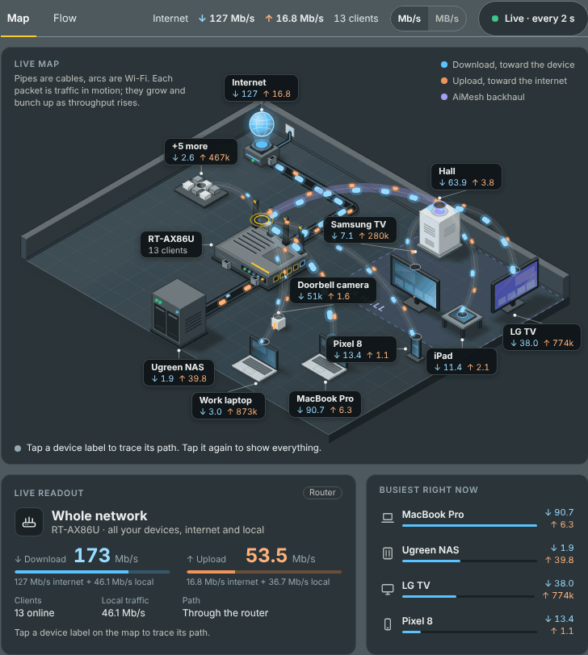
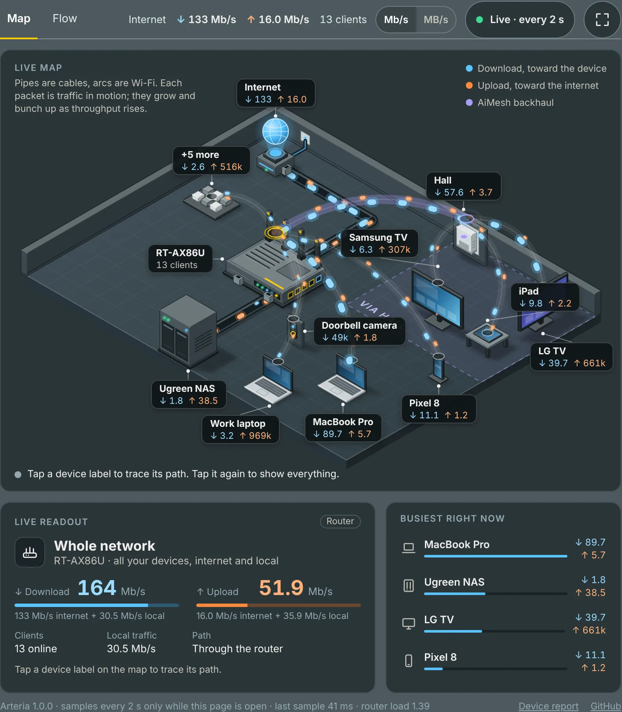
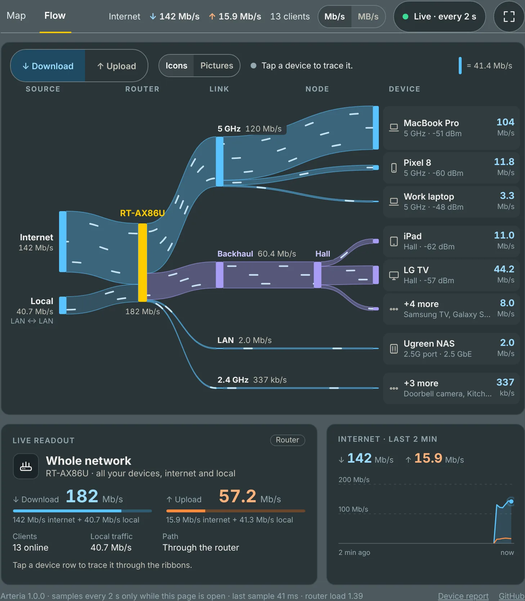
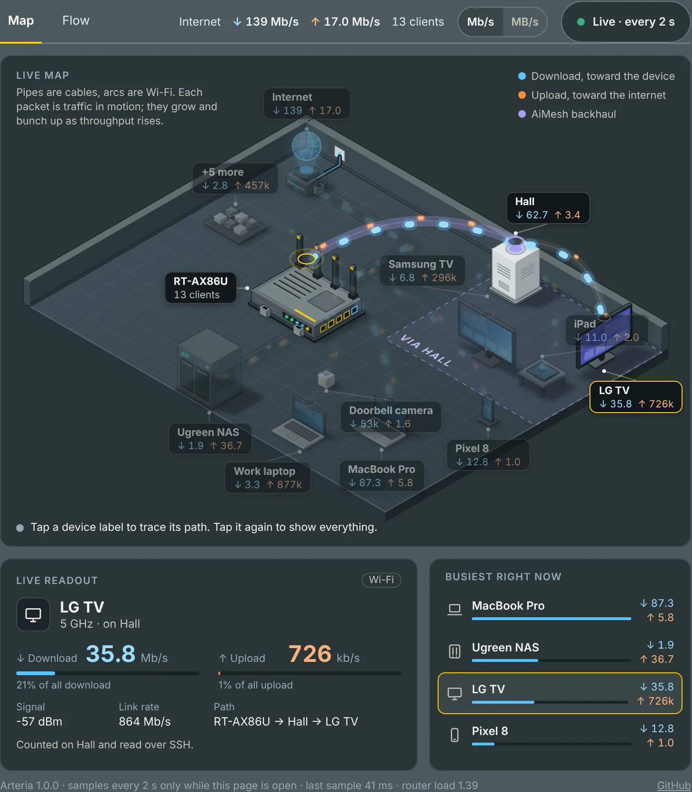
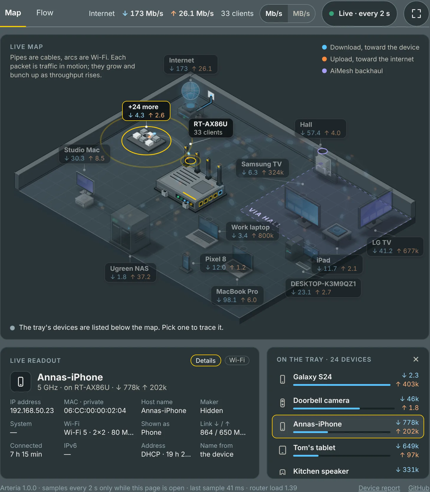
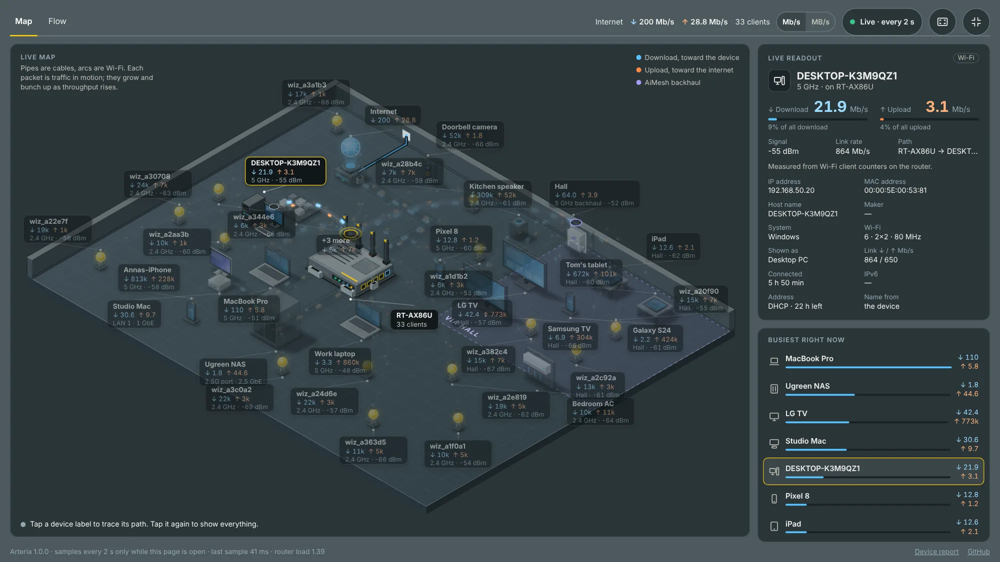

# Arteria for Asuswrt-Merlin

A live, animated map of how traffic flows through your home network: from the internet, through your router and its AiMesh nodes, to every device. Written for the RT-AX86U on 3004.388.x with an AiMesh node; other Broadcom models should work too, and `arteria.sh check` tells you before anything is installed.

Arteria only works while you're looking: it starts sampling when you open its page and stops about 20 seconds after you close it or switch to another tab. No cron jobs, no background service, nothing written to flash while it runs.

<p align="center"><br><sub>Made-up sample data. Re-recorded with <code>.github/demo-gif.py</code> when the page changes.</sub></p>

> [!WARNING]
> **Use it at your own risk.** Arteria was generated by Claude Opus 5.5, Anthropic's AI, with design help from Claude Fable 5.2. I'm a Java Principal Developer in the gaming (sports betting) industry, not a router firmware or shell scripting specialist: I described what I wanted and tested it on my own RT-AX86U. It runs as root on your router, hasn't had an independent security review, and is provided as is, without warranty ([MIT licence](LICENSE)). Please read [What it changes on your router](#what-it-changes-on-your-router), or the script itself, before installing. Reviews from people who know Merlin well are very welcome.

It adds a **Traffic Analyzer → Arteria** tab with two views:

| View | What it shows |
|---|---|
| **Map** | An isometric drawing of your network. Cables are pipes, Wi-Fi links are arcs, and each moving packet is traffic: packets grow and bunch up as throughput rises, at the same calm speed. Blue flows toward the device (download), orange toward the internet (upload), violet is the AiMesh backhaul. Each device is drawn as what it is (a desktop PC, a Mac, a phone, a TV, a light bulb...), and each AiMesh node in its own shape (a plug-in extender, a tower, a cube...). Devices connected through a node stand in its zone. On a busy network the quietest devices are grouped into a *+N more* tray: tap it to list them, then tap any of them to trace it. |
| **Flow** | A Sankey "river" from the internet (and traffic between your own devices) through the router, each band, port and node, to every device. Ribbon width follows throughput; switch between Download and Upload. Rows keep a fixed order, so nothing jumps around while you watch. |

Tap any device to trace its path: everything else dims, and the readout shows its download and upload, its share of the total, its signal, link rate and the path its traffic takes (for example *RT-AX86U → Hall → LG TV*). Its **Details** button shows who the device is: IP and MAC address, host name, maker, system, Wi-Fi standard and channel width (or port and speed), how long it has been connected, IPv6, and whether its address is reserved or leased (see [Devices](#devices)). Below the views: the busiest devices right now (Map) and the internet throughput of the last two minutes (Flow). The **Mb/s | MB/s** switch at the top shows every rate in megabits (as internet plans and speed tests do) or megabytes per second (as file downloads do); link rates stay in Mb/s, as the hardware states them. Notices flag a weak or offline backhaul and nodes that can't be read.

The **expand** button (top right) opens a bigger view that fills the browser window, with a full screen option. The map gets a bigger floor with room for every device on a typical home network (about 30 at 1600 × 900), larger drawings, and a third line on each label (band and signal, or port and speed). Flow gets a row for every device, with its address, signal and link rate, and scrolls when the rows don't fit. The readout moves to a column on the right and shows the traffic and the details together. Escape or the same button takes you back to the page, with the same device still selected.

## Screenshots

<table>
<tr>
<td width="50%"><a href="docs/map.webp"></a><br><b>Map</b>: every device, where it's connected and how much is flowing</td>
<td width="50%"><a href="docs/flow.webp"></a><br><b>Flow</b>: where the traffic goes, as a river</td>
</tr>
<tr>
<td width="50%"><a href="docs/map-sel.webp"></a><br><b>Tracing a device</b>: tap it to follow its traffic through the node</td>
<td width="50%"><a href="docs/details.webp"></a><br><b>Details</b>: who a device is and how it's connected</td>
</tr>
<tr>
<td colspan="2"><a href="docs/expanded.webp"></a><br><b>Expanded</b>: the whole window, a stand for every device, and more on each label</td>
</tr>
</table>

<sub>Screenshots use made-up sample data.</sub>

## Devices

Arteria draws each device as one of these kinds, with a drawing on the map and an icon in the lists:

| | |
|---|---|
| Computers | Desktop PC, Mac desktop (iMac, Mac mini, Mac Studio, Mac Pro), laptop |
| Phones and wearables | phone, tablet, watch |
| Entertainment | TV, streaming box, speaker, home cinema (soundbar), game console |
| Home and office | printer, NAS, network device (switch, access point) |
| Smart home | camera, doorbell, smart lock, thermostat, light, smart-home hub, air conditioner, robot vacuum, appliance, smart plug, sensor (motion, leak, smoke...), other smart device |

**How a kind is chosen**, first match wins:

1. **The icon you chose** for the device in the router's client list (*Network Map → Clients*), when it's a specific one.
2. **Its name**: the nickname you gave it, or its own host name (`DESKTOP-…` is a Windows PC, `Mac-Studio` a Mac desktop, `wiz_…` a bulb, `LGwebOSTV` a TV...).
3. **What the router detected**, and whether a Windows device is wired (a desktop) or on Wi-Fi (a laptop).
4. **Its maker** (from the MAC address) and the DHCP vendor class it sent.

**If a device is drawn as the wrong thing**, open the router's client list, pick the device and choose the icon that fits: Arteria follows your choice on the next refresh. Or give it a nickname that says what it is (*Study iMac*, *Garage camera*). If it's still wrong, the **Device report** link at the bottom of the page shows how each device was recognised, using only kinds, rule names and numbers (no names, MAC or IP addresses); paste it into an issue.

**Private Wi-Fi addresses.** Phones, tablets and computers (Apple's, Android's and Windows') can use a made-up MAC address per network, and some change it from time to time. Arteria marks these as *private* in Details (a private address says nothing about the maker). When a device turns up with a new private address and no name, Arteria looks for a named device that isn't connected right now and has the same distinctive host name (*Toms-iPad*, not a factory name like *iPhone*), and if exactly one matches, shows it under that name and icon (Details says *Matched by host name*). For the steadiest names, set Apple devices' **Private Wi-Fi Address** to **Fixed** for your home network (*Settings → Wi-Fi → ⓘ* on iPhone and iPad, *System Settings → Wi-Fi → Details* on a Mac); a fixed private address stays the same on that network.

## Requirements

- Asuswrt-Merlin with **JFFS custom scripts and configs** enabled (the installer turns it on if needed)
- Broadcom Wi-Fi whose driver reports per-client counters (`wl sta_info`; the installer checks)
- For each AiMesh node's devices: **SSH enabled** on the router (*Administration → System → Enable SSH*, LAN only is enough). AiMesh nodes follow that setting. Without it, the map shows each node's backhaul total only.

No Entware or USB drive needed.

## Install

Over SSH on the router:

```sh
curl -fsL --retry 3 "https://github.com/IfSugar/arteria/releases/latest/download/arteria.sh" -o /tmp/arteria.sh && sh /tmp/arteria.sh install
```

<details>
<summary>Without internet access on the router</summary>

Download `arteria.sh` and `arteria.asp` from this repo, copy both to the router (use your router's IP and SSH username), then run the installer:

```sh
scp -O arteria.sh arteria.asp admin@192.168.50.1:/tmp/
ssh admin@192.168.50.1 'sh /tmp/arteria.sh install'
```
</details>

The installer:

1. checks the requirements
2. copies the addon to `/jffs/addons/arteria/`, downloading the web page from this repo if it isn't next to the script
3. hooks itself into `services-start` and `service-event`
4. mounts the page
5. if you have AiMesh nodes, offers to give them the router's key (see [AiMesh nodes](#aimesh-nodes))

Open **Traffic Analyzer → Arteria**, the tab after *Statistic*. Routers without Traffic Analyzer (models without Trend Micro's engine, or not in router mode) get it as the last tab of **Network Tools** instead. If the tab doesn't show up, reload the router page with **Ctrl+F5** (Windows) or **Cmd+Shift+R** (Mac): browsers cache the router's menu. The installer also prints a direct link to the page.

**Updating:** run `/jffs/addons/arteria/arteria.sh update`. It asks GitHub for the latest release, and if that's a newer version it installs it over the old one, keeping your settings, the node key and the page slot. `update force` reinstalls the latest release. Only published releases are installed, never unreleased work.

**Trying unreleased changes:** `arteria.sh update dev` installs the newest code on `main`, and `update dev <branch>` the newest code on another branch of this repository, such as a fix waiting for release (menu option 8 does the same). Only branches here can be installed: pull requests from other people's forks and bare commit hashes are refused. Plain `update` (and amtm) takes you back to the latest release.

**Menu and amtm:** run `/jffs/addons/arteria/arteria.sh` with no arguments for a menu (status, test or set up node access, update, development version, debug report, amtm updates, uninstall). Arteria supports amtm's script updates (`amtmupdate`), see [amtm](#amtm).

## AiMesh nodes

The router only knows a node's backhaul: the total going to and from it. To show the devices connected to each node, Arteria asks the node itself, over SSH, while the page is open.

- **A key only the router holds.** At install, Arteria creates an SSH key in `/jffs/addons/arteria/node_key` and offers to add its public half to each node's authorized keys. That asks for the node's password once (your router's admin password, which AiMesh nodes share); it goes to the node only and is never stored. Run `arteria.sh nodekey` any time to do it later, or again after a node was reset. Like your own SSH key would be, it's a full admin login on each node, so it never leaves the router (readable by root only). AiMesh doesn't copy the router's authorized keys to its nodes, so this is needed even if you log in to the router with a key.
- **One session per node, only while the page is open.** The router keeps one SSH session to each node, on the router's SSH port and with its admin name. The node runs a small read-only loop that prints its clients' counters every 2 seconds. When you close the page the router hangs up and the loop ends; it also ends by itself after 30 minutes.
- **Key login only.** Arteria never offers a node a password: key logins use Dropbear's `-o BatchMode=yes` (Dropbear 2024.84 and later; Merlin 3004.388.13 has 2026.94), and the sampler has no terminal anyway. On an older SSH client, `nodes test` won't try the key from a terminal, since it couldn't stop a password prompt; the page still shows whether each node answers. If a node refuses the key, Arteria says so on the page and doesn't retry until the page is opened again. Each node's host key is pinned on first use, in `/jffs/addons/arteria/.ssh/known_hosts`. If a node later shows a different identity (after a reset or a firmware update, or if something else is answering at its address), the page says so and `nodekey` asks before trusting the new one, so your password never goes to a device that only claims to be the node.
- **If a node refuses the right password.** ASUS firmware locks out an address for a while after several failed logins, and then refuses even the right password from it (the node's `/tmp/protect_srv.log` shows it). A refused key doesn't count, a wrong password or user name does. Wait a while, or reboot the node, and run `nodekey` again. Or add the key on the node yourself: `arteria.sh nodekey print` shows one line to paste in an SSH session on the node, from any computer.
- **Nothing on the node changes** except the one line in its authorized keys. `arteria.sh nodes test` checks key login on every node. To stop reading nodes, set `NODES=off` in the config.

## How the numbers are made

Every 2 seconds while the page is open, the router writes one sample, and the page turns the differences between samples into rates (smoothed a little, so packets don't flicker).

- **Wi-Fi devices**: the driver's per-client byte counters (`wl sta_info`): what the router sent to the device is its download, what it received its upload. Signal and link rate come from the same place. On a node, the same counters, read on the node.
- **Wired devices**: the router's port counters (`/proc/net/dev`), with the bridge's address table telling which device is on which port. Several devices behind a switch on one port share one figure.
- **Internet**: the WAN interface's counters.
- **AiMesh backhaul**: the counters of the node's backhaul link (its Wi-Fi station or WDS link, or its wired port).
- **Local traffic** is what your devices send each other through the router, or to the router itself (its web pages, DNS answers, a USB share): all device traffic minus what went to the internet. That's why the **Whole network** readout is usually higher than the **Internet** figures: it's everything your devices received and sent, internet plus local, and its bars show the internet part solid and the local part lighter.
- **Names** come from the router's own client list: the nicknames you set, the names the router detected, DHCP host names and the AiMesh client list.
- **Details** come from the same places, plus the DHCP leases and reservations, the router's ARP table and IPv6 neighbours, and the Wi-Fi driver (standard, spatial streams and channel width). The page reads them once a minute while it's open.

Reading these counters doesn't disturb Wi-Fi, and no setting is ever changed.

## Files

| Path | Contents |
|---|---|
| `/jffs/addons/arteria/` | script, page, config, the node key (`node_key`), pinned node host keys (`.ssh/`), and `build` while a development version is installed |
| `/tmp/arteria/` | the sampler's working files: the heartbeat, the node sessions' output (RAM only) |
| `/tmp/var/wwwext/arteria/` | `live.htm` (the latest sample) and `names.htm` (device names), which the page reads (RAM only) |

## Commands

```sh
/jffs/addons/arteria/arteria.sh               # the menu (in a terminal; amtm opens this too)
/jffs/addons/arteria/arteria.sh check         # can this router run it? (changes nothing)
/jffs/addons/arteria/arteria.sh status        # is it sampling, node access, nodes
/jffs/addons/arteria/arteria.sh nodes test    # try key login on every AiMesh node
/jffs/addons/arteria/arteria.sh nodekey       # give the nodes the router's key (asks each node's password once)
/jffs/addons/arteria/arteria.sh nodekey 192.168.50.2   # only that node
/jffs/addons/arteria/arteria.sh nodekey print # the line to paste on a node yourself, to add the key there
/jffs/addons/arteria/arteria.sh sample        # print one sample as JSON (it has your devices' MAC and IP addresses: not for issues)
/jffs/addons/arteria/arteria.sh debug         # router, firmware and driver details for issues (no names or addresses)
/jffs/addons/arteria/arteria.sh startup       # re-apply the web page and menu entry
/jffs/addons/arteria/arteria.sh update        # install the latest release from GitHub
/jffs/addons/arteria/arteria.sh update dev    # install the newest unreleased code on main (or: update dev <branch>)
/jffs/addons/arteria/arteria.sh amtmupdate    # the same, for amtm: two lines of output, details in /tmp/arteria/amtmupdate.log
/jffs/addons/arteria/arteria.sh version       # print the installed version
/jffs/addons/arteria/arteria.sh uninstall     # remove everything
```

## Config (`/jffs/addons/arteria/config`)

Edit it, then run `arteria.sh startup`. The new values apply the next time the page starts sampling.

```sh
INTERVAL=2       # seconds between samples while the page is open (1-10)
IDLE_STOP=20     # stop sampling this many seconds after the last page closed (20-300)
NODES=on         # on: read each AiMesh node's devices over SSH; off: backhaul totals only
NODE_USER=""     # SSH user on the nodes; empty = the router's admin name
AMTM_UPDATE=on   # on: amtm may update Arteria; off: only 'update' does
```

## amtm

Arteria follows amtm's conventions for third-party scripts:

- **Menu:** with no arguments, in a terminal, the script shows its menu. Outside a terminal it prints the usage and exits.
- **Updates:** `arteria.sh amtmupdate check` exits 0 when amtm may update it, and 1 when you've turned that off (menu option 7, or `AMTM_UPDATE=off` in the config). `arteria.sh amtmupdate` installs the latest release, prints two lines and exits 0, or 1 if the update failed, leaving the installed version in place.
- **Version:** amtm reads it from the `VERSION="x.y.z"` line. The installed script is byte for byte the release's, so amtm's MD5 check matches.

| | |
|---|---|
| Script | `/jffs/addons/arteria/arteria.sh` |
| Version line | `^VERSION=` |
| Remote script | `https://github.com/IfSugar/arteria/releases/latest/download/arteria.sh` (the latest release, never unreleased work) |
| Check string | `IfSugar/arteria` |
| Install | download the remote script to `/tmp/arteria.sh`, then `sh /tmp/arteria.sh install` |
| Open | `/jffs/addons/arteria/arteria.sh` |
| Entware | not needed |

## What it changes on your router

- **Nothing until the checks pass.** `install` first verifies the firmware, the Addons API, the Broadcom driver's per-client counters, the shell tools it needs, JFFS space and a free page slot. If anything fails it stops without changing anything. Run `arteria.sh check` to see the checklist on its own.
- **JFFS (flash):** about 245 KB of addon files and the node key, written at install. One tagged line is added to each of `/jffs/scripts/services-start` and `service-event`. Nothing is written to flash while sampling, apart from a node's host key the first time Arteria connects to it.
- **Settings:** the only router setting it may change is *JFFS custom scripts and configs*, switched on if it's off.
- **AiMesh nodes:** when you run `nodekey` (or say yes at install), one line is added to each node's authorized keys (*Administration → System → Authorized Keys*, stored in the node's nvram). Nothing else on a node is changed.
- **RAM only (gone after a reboot, recreated at boot):** the web page, the menu entry and the sample files (a few KB). The menu is edited on a copy and swapped in only if the result is exactly one new line in a tab list (after *Statistic*, or last in *Network Tools*); otherwise it's left alone and the installer prints the page's direct link.
- **Load:** nothing at all while the page is closed. While it's open: one sample every 2 seconds at the lowest CPU priority (`nice 19`), plus one SSH session per node, each reading its own counters. The page's footer shows how long the last sample took and the router's load.
- **In your browser:** the page remembers its view, units, the Details switch, which Arteria tabs are open (so closing one doesn't stop the sampling another one shows) and, for re-recognising devices whose private address changed, which host name each device you named last used (up to 300, in the browser's local storage for the router's address; nothing is sent anywhere). Clear the site's data in the browser to remove it.
- **Login:** while the page is open and visible it polls the router every 2 seconds, so the router's automatic logout doesn't happen during that time. It does once you close the page or switch to another tab.

To remove everything: `arteria.sh uninstall`. The key line each node lists stays until you remove it from the node's *Authorized Keys* (or reset the node), but with the router's key deleted it no longer opens anything. If the web UI ever looks wrong, a reboot clears all RAM-side changes.

## Issues and security

Found a bug, have an idea, or run Arteria on another router? [Open an issue](https://github.com/IfSugar/arteria/issues/new/choose). The forms ask for the output of `check` and `debug`, which never include device names, MAC addresses or IP addresses.

Please report security problems privately: see the [security policy](.github/SECURITY.md).

## License

[MIT](LICENSE)
